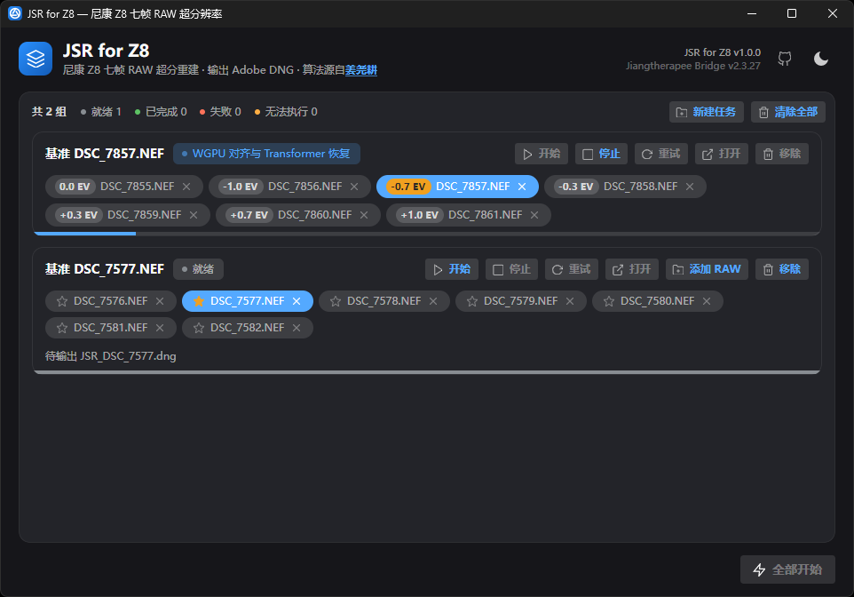

# JSR for Z8

**Nikon Z8 专用七帧 RAW 超分辨率桌面客户端** —— 把同一场景手持连拍的 7 张 RAW 拖进窗口，一键合成一张 **16560×11040 的线性 RAW**，可直接在 ACR / Lightroom 中打开。

## 功能特性

- **一键开始** —— 拖入 7 张 RAW 即可开始，无需额外设置
- **无缝的编辑体验** —— 输出无损继承原片拍摄参数（曝光/白平衡、镜头畸变与暗角校正、机型色彩匹配等），Adobe CameraRaw 可正确识别，与超分前的编辑体验完全一致，无需手动重调参数
- **曝光包围支持** —— 七帧仅快门速度不同也能合成+
- **全格式 NEF 支持** —— 无损压缩 / 高压缩★ / 高压缩 全格式支持
- **实时进度、随时停止** —— 重建进度全程可见，可随时停止
- **批量队列** —— 多组任务依次执行，互不影响
- **开箱即用** —— 单文件 exe，免安装

## 系统要求

| 项目 | 要求 |
| --- | --- |
| 系统 | Windows 10 / 11 x64 |
| 显卡 | 支持 Vulkan 的显卡（建议 8 GB 以上显存） |
| 内存 | 建议 8 GB 以上 |

## 下载与运行

从 [Releases](https://github.com/GoldJohnKing/JSR_for_Z8/releases/latest) 下载 `JSR4Z8_v1.2.1.exe`，双击运行即可，无需安装。

## 使用说明

1. **拖入 7 张 RAW** —— 同一场景连拍的 7 张 RAW 拖进窗口：七帧须在机型 / ISO / 压缩格式 / 画幅上一致，不符合时界面会直接提示。
2. **开始重建** —— 点「开始」。如需更改基准帧，可点击「★」或「±EV」标签；进度实时可见，可随时停止。
3. **取回结果** —— 在基准帧目录输出 `JSR_<基准帧名>.dng`，点卡片上的「打开」直达。

## 常见问题

**Q：重建一张要多久？**
取决于显卡；AMD 7900XTX 实测全幅七帧一组约 6 分钟。

**Q：输出有多大？**
16560×11040 / 1.8 亿像素，约 358 MB/张。

**Q：杀毒软件误报怎么办？**
如遇杀软误报，将程序所在目录与 `%LOCALAPPDATA%\JSR4Z8` 加入信任，重试即可。

## 参考项目与致谢

本仓库只做 Windows 图形界面与发布打包，超分辨率算法与计算引擎来自：

| 项目 | 说明 |
| --- | --- |
| [y-g-jiang/Jiangtherapee-Super-Resolution-World-Best](https://github.com/y-g-jiang/Jiangtherapee-Super-Resolution-World-Best) | 七帧 RAW 超分辨率算法与计算引擎 |
| [pdcgomes/redlamp-libraw](https://github.com/pdcgomes/redlamp-libraw) | 支持解码 Nikon HE / HE* 压缩格式 RAW |
| [GoldJohnKing/Save_Z8](https://github.com/GoldJohnKing/Save_Z8) | 导出 DNG 无损保留 NEF 原始拍摄参数 |
| [libjpeg-turbo](https://github.com/libjpeg-turbo/libjpeg-turbo) | 通用 JPEG 编解码库 |

第三方许可文件随程序分发（`resources\licenses\`）。

---

开发者信息（构建方式、架构设计）见 [AGENT.md](AGENT.md)。
